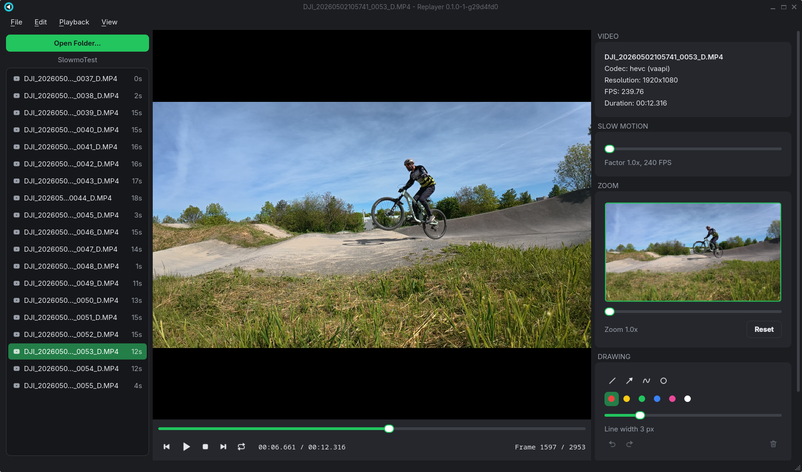
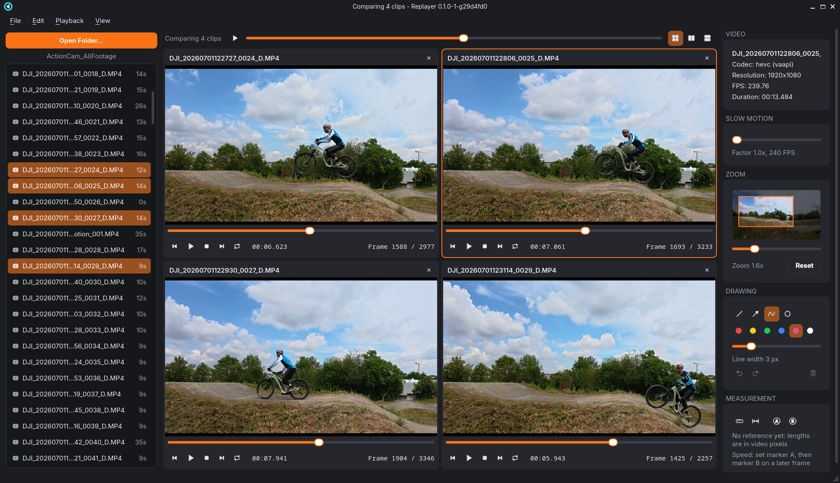
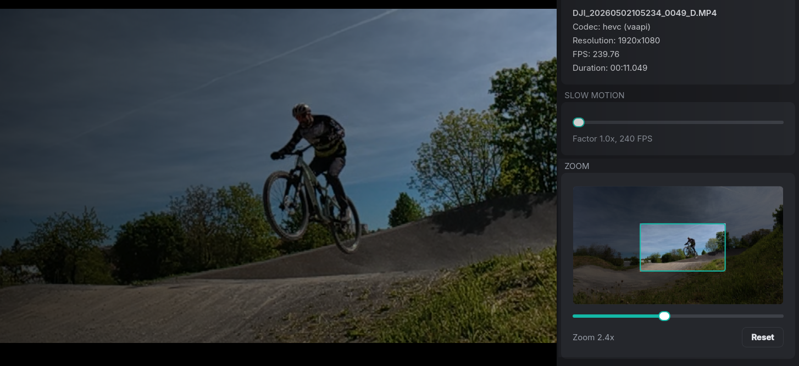
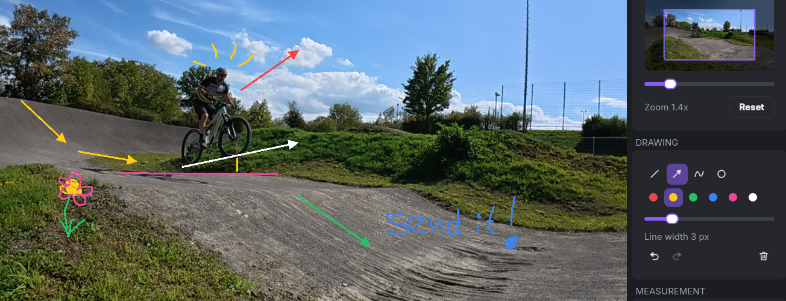
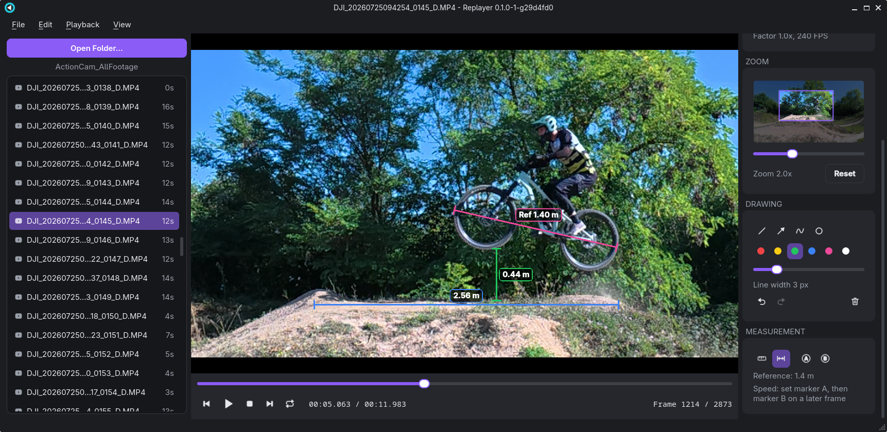
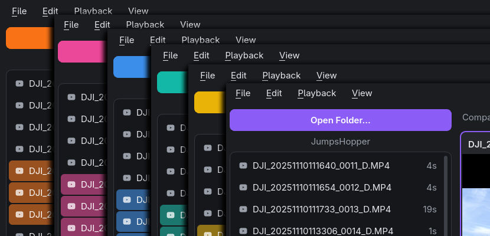

<p align="center">
  
</p>

<h1 align="center">Replayer</h1>

<p align="center">
  <b>Watch your best moments again – frame by frame, in buttery-smooth slow motion.</b><br>
  The video player built for action cam footage.
</p>

<p align="center">
  
  
  
  
</p>

<p align="center">
  
</p>

---

## 🚵 Made for people who want to get better

You nailed the jump – or almost did. What happened in that split second
between take-off and landing? Replayer lets you find out.

- **🎥 Analyse your action cam footage.** Open a whole session folder and
  flip through your clips in a second. GoPro chapters stay together.
- **🪞 Film yourself, then study your technique.** Set up the camera, do
  your run and watch every movement in detail – in slow motion or one
  frame at a time.
- **⏱️ Improve your timing.** Line up several attempts side by side and
  see exactly where one take-off was better than the other.

### Example: the mountain bike jump

Put your camera next to the kicker and do five runs. Back home, open the
folder, select all five clips and line them up at the take-off. Now play
them together in slow motion: Where did you pump? When did you pop? How
high was the front wheel? Measure the height and your speed at the lip,
and draw the line you want to take next time. Differences you never notice at full speed become
obvious.

The same works for skiing, skateboarding, climbing, running, golf, tennis –
anything you can film.

---

## ✨ Features

### ⚡ Super fast and hardware accelerated

Replayer uses your graphics card to decode and display video. Even 4K at
120 fps or 240 fps slow-motion footage plays smoothly – no stuttering, no
waiting.

### 🏎️ Snappy and responsive

Switching clips, scrubbing, stepping frame by frame: everything reacts
instantly. Each clip remembers where you left it, so you can jump back and
forth between takes without losing your spot.

### 🎬 Slow motion and frame stepping

Play back up to 20x slower, step forward and backward one frame at a time
and loop the interesting part as often as you like.

### 🧩 Play multiple videos in parallel

<p align="center">
  
</p>

Select up to six clips and watch them side by side. Align them at the key
moment, then play, pause and step them all in sync.

### 🔍 Zoom in on the action

<p align="center">
  
</p>

Zoom in up to 8x with the mouse wheel and drag to look at the details –
your hands, your feet, your line.

### ✏️ Draw on your clips

Mark what matters right on the video: lines, arrows, circles and freehand
strokes in six colours and any line width. Point out your body position,
the ideal line or the spot where you should have popped. Every clip keeps
its own drawings, and they stay in place when you zoom and pan. Made a
mistake? Undo, redo or clear with one click.

<p align="center">
  
</p>

### 📏 Measure distances and heights

Draw a reference line along something of known length – a bike wheel, a
ramp, a measuring tape – and enter its real length. From then on, every
measuring line shows its real length – in metres, centimetres, feet,
inches, whatever unit you entered. How high did you get? How far did you jump? Now you know.

<p align="center">
  
</p>

### 🚀 Measure your speed

Click a point – say, your front tyre – and set marker A. Step forward a
few frames, click the same point again and set marker B. Replayer turns the
distance and the time between the two frames into your speed, in km/h or
mph. Find out how fast you really were on the take-off.

### 🎨 Modern dark UI with your favourite colour

<p align="center">
  
</p>

A clean dark theme that keeps the focus on your video, with large,
easy-to-grab controls. Pick the accent colour you like best.

### 💻 Cross platform

Runs on **Windows** and **Linux**. On Windows, just unzip and start – no
installation needed. On Linux, there is a single AppImage.

### 💚 Free and open source

No ads. No telemetry. No subscription. No account. Replayer is free and
open source under the GNU GPL v3 – forever.

---

## ☕ Support the project

If Replayer helps you land that jump, you can buy me a coffee. Thank you!

<a href="https://www.buymeacoffee.com/borisbrock" target="_blank"></a>

---

## ⌨️ Keyboard shortcuts

| Key                     | Action                              |
|-------------------------|-------------------------------------|
| Down / Up (PgDn / PgUp) | Next / previous clip                |
| Ctrl+click, Shift+click | Select clips to compare             |
| Space                   | Play / pause                        |
| S                       | Stop (rewind to start)              |
| L                       | Loop clip on / off                  |
| `.` / `,`               | Next / previous frame               |
| Right / Left            | Seek forward / back 1 s             |
| Shift+Right / Left      | Seek forward / back 5 s             |
| `+` / `-`, mouse wheel  | Zoom in / out                       |
| `0`                     | Reset zoom                          |
| Drag on the video       | Pan (when zoomed in)                |
| F, F11, double-click    | Toggle full screen                  |
| Esc                     | Leave full screen / put tool away   |
| Ctrl+Z                  | Undo drawing                        |
| Ctrl+Y, Ctrl+Shift+Z    | Redo drawing                        |
| Ctrl+Delete             | Clear drawings of the current clip  |
| Ctrl+O                  | Open folder                         |
| Ctrl+Shift+O            | Open a single file (and its folder) |

When comparing clips, the playback shortcuts act on all of them at once.

---

## 🛠️ Building from source

<details>
<summary>Requirements and build instructions</summary>

### Requirements

- Qt 6.2 or newer (Core, Gui, Widgets, OpenGLWidgets)
- FFmpeg 5.1 or newer (libavcodec, libavformat, libavutil, libswscale)
- CMake 3.21+, pkg-config, a C++17 compiler
- OpenGL 3.0 (or 2.1 with `ARB_texture_rg`)

### Linux

On Debian/Ubuntu:

```bash
sudo apt install build-essential cmake ninja-build pkg-config qt6-base-dev \
    libavcodec-dev libavformat-dev libavutil-dev libswscale-dev
cmake -S . -B build -G Ninja
cmake --build build
./build/replayer [folder or file]
```

To package an AppImage, run `./build.sh`. The result is
`dist/replayer-<version>-x86_64.AppImage`.

### Windows

Requires Visual Studio 2022 with the C++ workload, CMake, Qt 6 for MSVC 2022
64-bit (Qt Online Installer or [aqtinstall](https://github.com/miurahr/aqtinstall))
and a shared FFmpeg build with MSVC import libraries, e.g.
`ffmpeg-*-win64-lgpl-shared` from
[BtbN/FFmpeg-Builds](https://github.com/BtbN/FFmpeg-Builds). Without
pkg-config, CMake finds FFmpeg through `-DFFMPEG_ROOT=<dir>`.

```powershell
.\build.ps1 -QtDir D:\dev\Qt\6.8.3\msvc2022_64 -FFmpegDir D:\dev\ffmpeg
```

The paths can also be set with `QT_DIR` and `FFMPEG_DIR`. The result is a
portable folder and `dist\replayer-<version>-win64.zip` with all Qt, FFmpeg
and MSVC runtime DLLs included.

### Versions and releases

The version comes from the git tags: a build 5 commits after `v2.0.0` is
`2.0.0-5-gabc1234`. To set it explicitly, pass `-DREPLAYER_VERSION=2.0.0` to
CMake, `-Version 2.0.0` to `build.ps1`, or set `REPLAYER_VERSION` for
`build.sh`.

To publish a release, push a tag like `v2.0.0`. The release workflow builds
both packages with version `2.0.0` and attaches them to the GitHub release
`2.0.0`. Tags like `v2.0.0-rc1` and 0.x versions become pre-releases.

### Troubleshooting

Set `REPLAYER_HWDEC` to choose the decoder: `none` forces software
decoding, and a device name such as `vaapi`, `cuda`, `d3d11va` or
`videotoolbox` selects that API. The info panel shows the decoder in use next
to the codec.

</details>

---

## 📄 License

Replayer is free software, licensed under the
[GNU General Public License v3.0](LICENSE). You may use, share and change it,
but anything you distribute that is based on it must be released under the
same license, with its source code.

Replayer uses [Qt](https://www.qt.io) (LGPLv3) and
[FFmpeg](https://ffmpeg.org) (LGPL on Windows, GPL in the AppImage). See
[THIRD-PARTY-NOTICES.md](THIRD-PARTY-NOTICES.md) for details.
